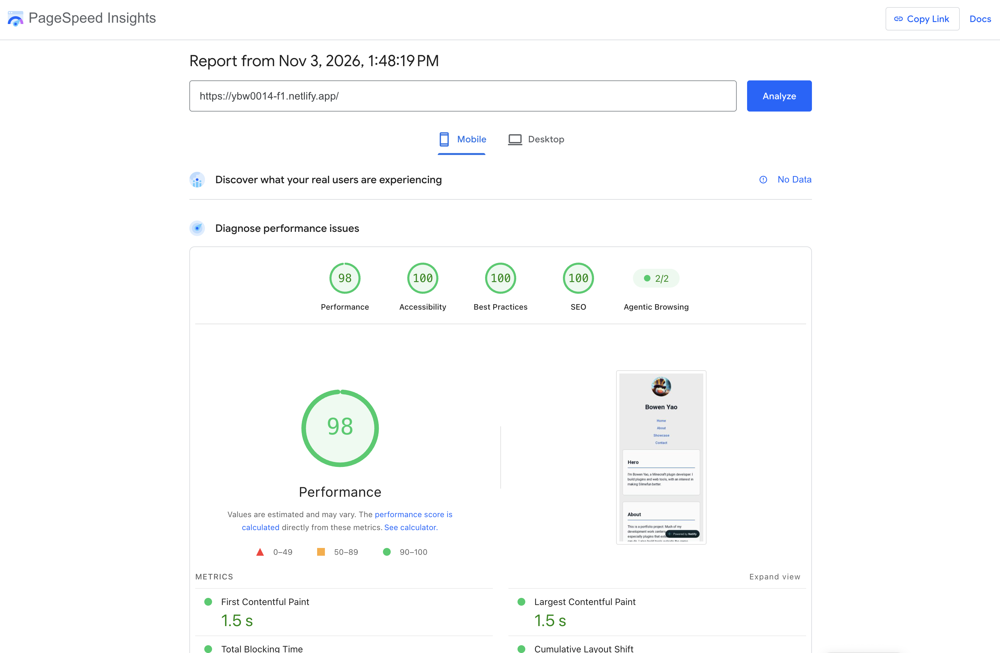

# Accessibility Report

The initial scan reports an accessibility score of 95. The only issue is background and foreground colors do not have a sufficient contrast ratio.

I changed the primary color to a darker #2f62d3. The scan after change reports a score of 100.

